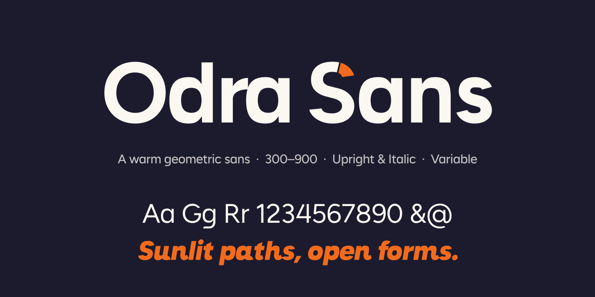
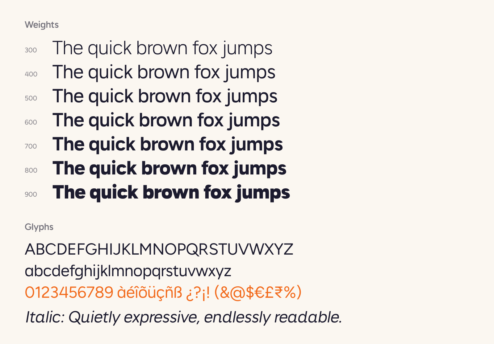

# Odra Sans



Odra Sans is a warm geometric sans-serif typeface for screens, interfaces and brands. It has a single-storey **a**, an open single-storey **g** with a flat, angled tail, angled terminals on **c e f s t**, a generous x-height and slightly squared round letters. The name comes from Odra, the historic name of Odisha in India.



## Features

- **7 weights**, Light (300) to Black (900), each with a matching **italic**
- **Variable fonts** with a `wght` axis (300–900), upright and italic
- **Latin coverage**, including Western and Central European languages
- Proportional and tabular figures, fractions, superiors and inferiors, and a stylistic set with a double-storey a (`ss01`)
- Hinted static fonts and WOFF2 web fonts

## Install

Download the fonts from `fonts/`:

| Folder | Use |
|---|---|
| `fonts/variable/` | Variable TTF for desktop apps and design tools |
| `fonts/ttf/` | Static TTF, one file per style |
| `fonts/webfonts/` | WOFF2 for the web |

### Use on the web

```css
@font-face {
  font-family: "Odra Sans";
  src: url("fonts/webfonts/OdraSans[wght].woff2") format("woff2");
  font-weight: 300 900;
  font-style: normal;
  font-display: swap;
}
@font-face {
  font-family: "Odra Sans";
  src: url("fonts/webfonts/OdraSans-Italic[wght].woff2") format("woff2");
  font-weight: 300 900;
  font-style: italic;
  font-display: swap;
}

body { font-family: "Odra Sans", system-ui, sans-serif; }
h1   { font-weight: 800; }
.num { font-variant-numeric: tabular-nums; }
```

The repository follows the layout Fontsource expects, so it can be listed as an npm package (`@fontsource/odra-sans`, `@fontsource-variable/odra-sans`). See `documentation/fontsource-metadata.json`.

## Build

You need Python 3.10 or newer.

```bash
make build      # creates a venv, installs requirements.txt, runs scripts/build.sh
make test       # runs Font Bakery (Google Fonts profile) on the variable fonts
```

Or run it by hand:

```bash
python3 -m venv venv && source venv/bin/activate
pip install -r requirements.txt
./scripts/build.sh
```

The UFO and designspace sources are in `sources/`. The build writes variable, static and WOFF2 fonts to `fonts/`.

## License

Odra Sans is licensed under the [SIL Open Font License, Version 1.1](OFL.txt). You can use it freely in personal and commercial work, and bundle, embed and modify it, as long as the fonts themselves are not sold alone.

## Credits

Designed by Abhilash Sahoo. See [AUTHORS.txt](AUTHORS.txt) and [FONTLOG.txt](FONTLOG.txt).
